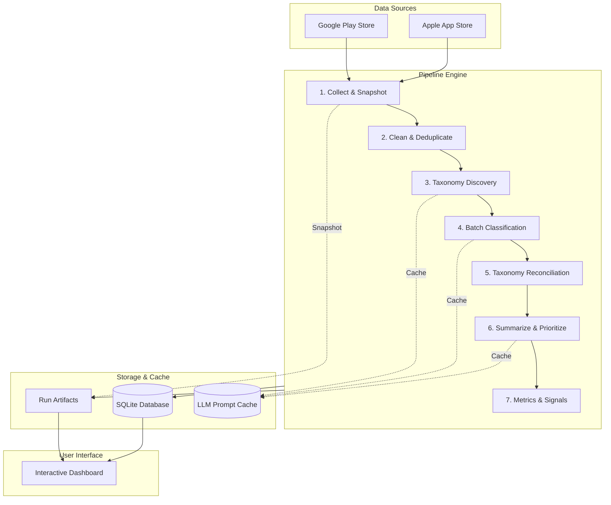

# Review Intelligence MVP

Turn mobile app reviews from Google Play Store and Apple App Store into an actionable, prioritized, and version-aware product feedback report.

---

## Architecture Overview



---

## Quickstart

### Option A: Docker Compose (Recommended)

1. Set up your environment file:
   ```bash
   cp .env.example .env
   # Add your GEMINI_API_KEY in .env
   ```

2. Start the service:
   ```bash
   docker compose up --build
   ```

3. Open the dashboard in your browser:
   ```
   http://localhost:8000/dashboard
   ```

> Data and LLM prompt caches persist across container restarts using a Docker named volume (`review_intel_data`).

### Option B: Local Setup

1. Install dependencies:
   ```bash
   python3 -m venv .venv
   source .venv/bin/activate
   pip install -r requirements.txt
   ```

2. Configure environment:
   ```bash
   export GEMINI_API_KEY="your_api_key_here"
   export LLM_MODEL="gemini-2.5-flash"
   export DATA_DIR="./data"
   ```

3. Start the server:
   ```bash
   uvicorn app.main:app --host 0.0.0.0 --port 8000
   ```
   Navigate to `http://localhost:8000/dashboard`.

---

## Features

- **Store Ingestion:** Scrapes reviews from Google Play Store and Apple App Store (India storefront).
- **Text Sanitization & Deduplication:** NFKC normalization, Indian PII scrubbing (+91 mobile numbers, emails), Hinglish language support, and RapidFuzz near-duplicate removal.
- **Dynamic Taxonomy Discovery:** Discovers complaint categories from a stratified sample, expanding the taxonomy as new issues emerge.
- **Multi-Label Classification:** Categorizes complaints with ordinal relevance (1–5) and severity (1–5) scores.
- **Priority Action Plan:** Deterministic code formula ranks categories by volume share, severity, rating drag, recency, and growth trend.
- **Interactive Dashboard:** Chart.js visual trends, version progression table, category × version heatmap, proof review citations, and unaddressed feedback exports.
- **Reproducible Runs:** Immutable run snapshots and SHA-256 prompt caching guarantee deterministic replays.

---

## CLI & Testing

```bash
# Run unit, contract, and e2e integration test suites
pytest -v

# Run offline smoke test with synthetic fixtures (no API key needed)
python scripts/smoke.py --offline --sample-size 50

# Run live smoke test against Play Store reviews
python scripts/smoke.py --app-name "Swiggy" --play-package "in.swiggy.android" --sample-size 50

# Run an individual pipeline stage standalone
python -m app.pipeline.s04_classify --run-id <run_id>
```

---

## Key Constraints

- **India Storefront Focus:** Country is fixed to `in` for both stores in v1.
- **App Store Volume Cap:** Apple's public RSS feed is capped at 10 pages (~500 reviews max).
- **Apple Developer Replies:** Public App Store RSS feeds do not expose developer responses; iOS reviews are marked `has_dev_reply=null` ("N/A for App Store").
- **Single Worker Process:** The web process runs with a single Uvicorn worker to preserve SQLite WAL concurrency and sequential background execution.
